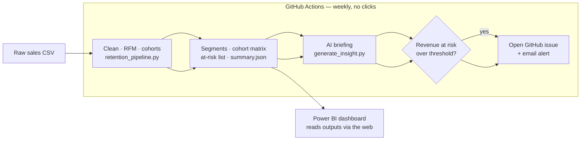

# Customer-Retention BI System — Nordwind

**An end-to-end customer-retention pipeline that cleans raw e-commerce sales, scores every customer, flags the revenue at risk of churning, visualises it in Power BI, and re-runs itself every week on GitHub — opening an alert with an AI-written briefing when the risk gets too high.**

Built as a flagship analytics-engineering project: not just an analysis, but a **hands-off system** that goes from raw data to a plain-language decision, automatically.

---

## What it does

For any online store, keeping a customer is far cheaper than winning a new one, so the quiet killer is **churn** — customers who buy once or twice and disappear. This project answers, automatically and every week:

- **Who is slipping away?** (customer segmentation)
- **How much money do they represent?** (revenue at risk)
- **What should the team do about it?** (an AI-written action list)

The data is the public **UCI Online Retail** dataset (~541k transactions, a UK online retailer), standing in for a store called *Nordwind*.

---

## The system



**Seven stages, one automated pipeline:**

1. **Clean** 540k+ raw transactions into trustworthy sales (drops cancellations, bad rows, duplicates, and non-sale accounting adjustments).
2. **Score** each customer by **R**ecency, **F**requency and **M**onetary value (1–5), then map them to plain segments — Champions, Loyal, At Risk, Lost, Needs Attention, New / Promising.
3. **Measure** retention over time with a **cohort analysis** and compute the **revenue at risk** (At Risk + Lost).
4. **Visualise** on a two-page **Power BI** dashboard (executive overview + retention deep-dive), which reads the pipeline's published CSVs over the web.
5. **Automate** the whole run on **GitHub Actions** — a fresh cloud machine does it weekly on a schedule.
6. **Alert** — when revenue at risk crosses a threshold, it opens a GitHub issue with the win-back customer list (GitHub emails it to the owner).
7. **Explain** — an **AI step (Google Gemini)** writes a short, plain-language briefing of the week plus the top 3 actions, and places it at the top of the alert.

A live example of the AI briefing: [`output/insight.md`](output/insight.md)

---

## Key results

| Metric | Value |
| --- | --- |
| Raw transactions | 541,909 |
| Clean sales rows | 524,877 |
| Revenue analysed | £10.63M |
| Customers scored (RFM) | 4,338 |
| Repeat-customer rate | 66% (repeat customers drive 93% of revenue) |
| **Revenue at risk** (At Risk + Lost) | **£1.32M** |
| At-risk customers | 1,708 |

> **Data-quality note:** the pipeline catches and removes a £11,062 "bad debt" accounting adjustment that was inflating revenue — a reminder that not every row with a price is a sale.

---

## Run it yourself

```bash
pip install -r requirements.txt

# 1) the analytics pipeline (produces the CSVs + summary.json)
python retention_pipeline.py --input online_retail.csv --outdir output

# 2) the AI briefing (optional — needs a free Gemini API key)
export GEMINI_API_KEY=your_key_here
python generate_insight.py --outdir output --model gemini-3.8-flash
```

Outputs land in `output/`: `online_retail_clean.csv`, `customer_rfm_segments.csv`, `cohort_retention.csv`, `at_risk_customers.csv`, `summary.json`, and `insight.md`.

In automation, the API key is stored as a **GitHub Actions secret** (`GEMINI_API_KEY`) — never in the code. If the key is missing or the model is unavailable, the insight step writes a plain fallback summary so the pipeline never breaks.

---

## Repo structure

```
retention_pipeline.py        # clean → RFM → segments → cohorts → at-risk → summary.json
generate_insight.py          # AI briefing from the numbers (Google Gemini, with fallback)
requirements.txt             # pandas, google-genai
online_retail.zip            # the source dataset
.github/workflows/retention.yml   # the weekly automation (run, publish, alert, insight)
output/                      # published results the dashboard reads + the AI briefing
```

---

## Tech stack

**Python** (pandas) · **Power BI** (DAX, data modelling) · **RFM & cohort analysis** · **GitHub Actions** (CI/CD) · **Google Gemini API** · prompt engineering

---

## Author

**Nonso Ezeoma** — Business Data Analyst & AI Automation Specialist, Berlin
[nonso-analytics.com](https://nonso-analytics.com) · [LinkedIn](https://linkedin.com/in/nonso-ezeoma)
